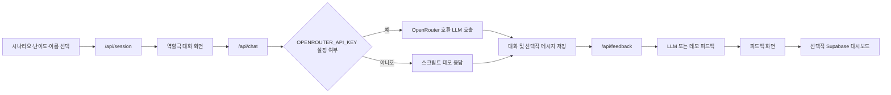

# AI 직무 롤플레이 시뮬레이터

[English](README.md) · [프로젝트 자세히 보기](PORTFOLIO.ko.md)

고객 응대·면접·영업 중 하나와 난이도를 고르면 LLM 상대와 역할극을 하고, 대화가 끝나면 강점·개선점과 0~100점 척도의 네 가지 점수가 담긴 LLM 피드백 보고서를 받는 Next.js 웹앱입니다.

이런 대화를 연습하려면 보통 역할을 유지하며 상대해 주고 끝난 뒤 피드백까지 줄 사람이 필요합니다. 이 앱은 그 두 가지를 맡고, LLM 키가 없을 때는 미리 작성한 데모 경로로 동작합니다.

**구현 범위:** `lib/personas.ts`의 시나리오 프롬프트 9개(3개 범주 x 3개 난이도), 세션·채팅·피드백 API 라우트, `OPENROUTER_API_KEY`가 있으면 OpenRouter(여러 LLM을 묶은 호스팅 게이트웨이)로 LLM을 호출하고 없으면 스크립트 데모 응답을 쓰는 분기, 그리고 선택 기능인 Supabase(인증을 갖춘 호스팅 Postgres) 저장과 Google 로그인입니다. 커밋은 2026년 4월 6일~13일에 걸쳐 있고, 처음의 Next.js 기본 골격 커밋을 빼면 모두 저장소 소유자 계정으로 기록돼 있으며 팀 구성은 기록돼 있지 않습니다.

**바로 실행:** `npm ci` 후 `npm run dev`. 키가 없어도 채팅과 피드백은 데모 내용을 반환합니다([Supabase 관련 주의](#로컬-실행) 참고).

> **범위 안내:** 저장소에는 소스 코드가 들어 있습니다. 배포 서비스, 사용자 연구, 응답 지연 시간, 채용 성과, 모델 품질 평가를 검증한 자료는 포함하지 않습니다. 피드백 점수는 LLM이 생성하는 연습용 의견이며, 검증된 평가나 자동 채용 판단에 사용하면 안 됩니다.

바로 가기: [사례 연구와 설계 판단](PORTFOLIO.ko.md) · [앱 흐름](#앱-흐름) · [로컬 실행과 데모 모드](#로컬-실행) · [알려진 문제](#알려진-문제)

## 구현한 기능

LLM이 생성하는 부분은 따로 표시했고, 나머지는 결정적으로 동작하는 코드입니다.

- 고객 응대·면접·영업 3개 범주와 초급·중급·고급 3단계 프롬프트를 `lib/personas.ts`에 정의했습니다. 시나리오별 첫 대사는 고정 문구입니다.
- `/api/session`에서 세션을 만들며, Supabase를 설정하지 않은 경우 UUID를 대신 사용합니다.
- `/api/chat`은 `OPENROUTER_API_KEY`가 있으면 OpenRouter 호환 클라이언트로 LLM을 호출하고(**LLM 생성** 응답), 없으면 미리 작성한 데모 응답을 반환합니다.
- `/api/feedback`은 강점·개선점과 네 가지 수치 점수를 LLM에 요청합니다(**LLM 생성**). API 키가 없을 때는 고정된 데모 피드백을 보여 줍니다.
- Google OAuth, Supabase 저장, 세션별 피드백, 로그인 사용자의 누적 피드백 대시보드는 선택 기능입니다.

## 앱 흐름



## 구조와 데이터 처리

| 계층 | 역할 | 근거 파일 |
|---|---|---|
| 클라이언트 | 시나리오 선택, 채팅, 피드백, 대시보드, webview 안내 | `app/`, `components/` |
| API | 세션 수명주기, 역할극 응답, 구조화된 피드백 요청 | `app/api/session/route.ts`, `app/api/chat/route.ts`, `app/api/feedback/route.ts` |
| LLM | persona 프롬프트와 OpenRouter 호환 chat completion | `lib/personas.ts`, API routes |
| 저장 | Supabase 브라우저 클라이언트와 sessions·messages·feedback 테이블 | `lib/supabase.ts`, `lib/auth.ts` |

Supabase 자격증명이 없으면 API 라우트는 의도적으로 데모 경로를 사용합니다. 이때 피드백은 브라우저의 `sessionStorage`에만 남고, 영구적인 사용자 이력이 아닙니다.

## 환경 변수

[`.env.example`](.env.example)을 `.env.local`로 복사한 뒤 사용할 연동만 채웁니다.

| 변수 | 설정했을 때 | 비워 두었을 때 |
|---|---|---|
| `OPENROUTER_API_KEY` | 실제 LLM 응답과 피드백 | 스크립트 데모 응답과 고정 데모 피드백 |
| `OPENROUTER_MODEL` | 모델 변경 | `google/gemini-2.0-flash-exp:free`(소스 기본값) |
| `NEXT_PUBLIC_SUPABASE_URL`, `NEXT_PUBLIC_SUPABASE_ANON_KEY` | Google 로그인과 데이터베이스 저장 | 임의 세션 UUID, 피드백은 `sessionStorage`에 보관 |

타입 선언은 `sessions`, `messages`, `feedback` 테이블을 기대합니다. 다만 이 체크아웃에는 테이블 스키마와 RLS SQL이 버전 관리돼 있지 않으므로, 실제 연결 전에는 별도 설정과 접근 정책 검증이 필요합니다.

## 로컬 실행

사전 조건은 Node.js 18.18 이상입니다(Next.js 15 요구 사항이며, 패키지에 `engines` 필드는 지정돼 있지 않습니다). 패키지 스크립트는 Next.js 15.1.4를 사용합니다.

```powershell
npm ci
copy .env.example .env.local   # 선택 사항, 위 표 참고
npm run dev
```

Next.js가 출력하는 로컬 URL을 열면 됩니다.

**실행 점검 현황.** 2026년 11월에 불완전한 로컬 `node_modules`로 `npm run lint`와 `npm run build`를 시도했으나 `next`·`eslint` 실행 파일이 없어 시작되지 않았습니다. 따라서 깨끗한 `npm ci` 설치에서 두 명령이 통과하는지는 확인되지 않았습니다. 또한 `next.config.ts`가 `eslint.ignoreDuringBuilds`와 `typescript.ignoreBuildErrors`를 켜 두었으므로, 빌드가 성공하더라도 lint나 타입 검사를 통과했다는 뜻은 아닙니다.

**키 없이 쓰는 데모 모드.** 변수를 하나도 설정하지 않으면 `/api/chat`과 `/api/feedback`은 스크립트 응답을, `/api/session`은 임의 UUID를 반환합니다. 그러나 첫 화면과 로그인 버튼이 화면을 불러올 때 Supabase 클라이언트를 호출하고, `lib/supabase.ts`는 Supabase 변수가 없으면 오류를 던집니다. 그래서 Supabase 변수 없이 브라우저에서 정상 동작하는지는 확인되지 않았습니다. 이 내용은 코드를 읽어 확인한 것이며 실행으로 확인한 것은 아닙니다.

## 피드백 점수의 사용 범위

피드백 API는 `total_score`, `empathy_score`, `problem_solving_score`, `communication_score`를 받습니다. 루브릭 보정 데이터, 사람 평가자 간 일치도, 테스트셋, 공정성 분석, 신뢰도 근거는 저장소에 없습니다. 이 결과는 연습을 돌아보기 위한 의견으로만 쓰고, 고용·교육·기타 고위험 판단에 사용하지 않습니다.

## 알려진 문제

- 피드백 화면과 대시보드가 `empathy_score`를 "COMMUNICATION"으로, `communication_score`를 "ADAPTABILITY"로 표시합니다(`app/feedback/page.tsx`, `app/dashboard/page.tsx`). 화면의 이름표가 프롬프트가 요청하는 항목과 맞지 않습니다.
- 피드백 라우트는 모델 출력 텍스트를 스키마 검증 없이 JSON으로 파싱하므로, 형식이 깨진 응답이 오면 HTTP 500을 반환합니다.
- [로컬 실행](#로컬-실행)에서 설명한 Supabase 초기 호출 의존성이 있습니다.

## 저장소 구조

```text
app/          # 세션·채팅·피드백 API와 화면
components/   # 인증 및 webview UI 보조 컴포넌트
lib/          # persona, Supabase 클라이언트, 인증 도우미
public/       # 로고와 favicon
.env.example  # 변수 이름만 기재(값 없음)
```

## 한계와 다음 단계

- Supabase 스키마·RLS 정책·통합 테스트를 저장소에서 관리한 뒤에야 저장 기능과 접근 제어를 운영 수준으로 볼 수 있습니다.
- 문서화된 루브릭, 사람 검토, 신뢰도 측정, 명확한 점수 이름표로 LLM 피드백을 검증합니다.
- 데모 모드의 클라이언트 입력을 제한하고, 악용 방지·rate limit·관측 기능을 추가합니다.
- 현재 배포 상태, 지원 공급자·모델, 브라우저 동작은 따로 확인해야 하며, 배포 근거는 저장소에 없습니다.

## 문서

- [포트폴리오 사례 연구](PORTFOLIO.ko.md)
- [프로젝트 리뷰](docs/PROJECT_REVIEW.md)
- [아키텍처](docs/ARCHITECTURE.md)
- [CV 활용 가이드](docs/CV_BULLETS.md)
