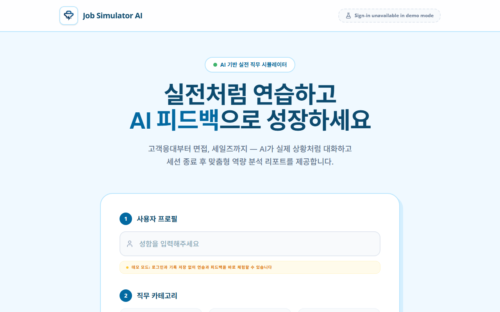
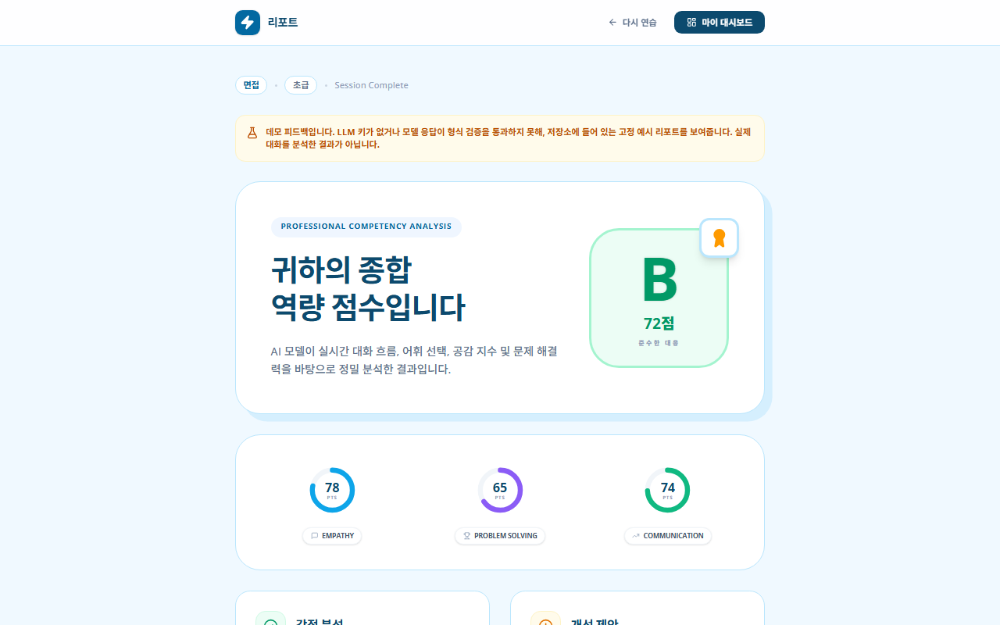
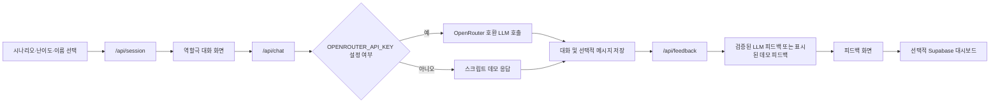

# Job Simulator AI

면접·고객 응대·영업 대화를 LLM 역할극으로 연습하는 앱.

[English](README.md) · [사례 연구](PORTFOLIO.ko.md)

2026년 제1회 KEG 바이브코딩 콘테스트 개발 기간(2026년 4월 6일–13일, 8일) 동안 제작.

<p>
  
  
</p>

*환경 변수 없는 데모 모드: 첫 화면(왼쪽)과 데모로 표시된 피드백 보고서(오른쪽).*

Next.js 웹앱입니다. 대화 유형과 난이도를 고르면 LLM 상대와 역할극을 하고, 대화가 끝나면 강점·개선점과 0~100점 척도의 네 가지 점수(종합, 공감, 문제 해결, 커뮤니케이션)가 담긴 LLM 피드백 보고서를 받습니다.

**문제.** 취업 준비생이나 신입 상담·영업 직원은 끝까지 역할을 지키는 상대와 어려운 대화를 연습하고, 정해진 형식(강점, 개선점, 0~100점 4개)의 피드백을 받아 볼 기회가 드뭅니다.

**구현 범위.** `lib/personas.ts`의 시나리오 프롬프트 9개(3개 범주 x 3개 난이도), 세션·채팅·피드백 API 라우트, `OPENROUTER_API_KEY`가 있으면 OpenRouter(여러 LLM을 묶은 호스팅 게이트웨이)로 LLM을 호출하고 없으면 스크립트 데모 응답을 쓰는 분기, 선택 기능인 Supabase(인증을 갖춘 호스팅 Postgres) 저장과 Google 로그인.

**역할.** Next.js 기본 템플릿 위에 앱을 직접 만들고 문서를 작성했습니다.

**범위.** 연습 흐름이 동작함을 보여줄 뿐 코칭 효과를 입증하지는 않습니다. 배포·사용자 연구·모델 품질 평가가 없고, 네 가지 점수는 루브릭 보정 없이 LLM이 생성합니다.

**바로 실행.** `npm ci` 후 `npm run dev`. 키가 없어도 됩니다. 시나리오 선택, 대화, 피드백까지 전체 흐름이 데모 내용으로 동작하고, 헤더에는 "Sign-in unavailable in demo mode"가 표시됩니다. 환경 변수 없이 `npm test`, `npm run lint`, `npx tsc --noEmit`, `npm run build`가 통과합니다.

## 한눈에 보기

LLM이 생성하는 부분은 따로 표시했고, 나머지는 LLM을 거치지 않는 일반 코드입니다.

- 고객 응대·면접·영업 3개 범주와 초급·중급·고급 3단계 프롬프트를 `lib/personas.ts`에 정의합니다. 시나리오별 첫 대사는 고정 문구입니다.
- `/api/session`에서 세션을 만들며, Supabase를 설정하지 않으면 UUID를 대신 씁니다.
- `/api/chat`은 `OPENROUTER_API_KEY`가 있으면 OpenRouter 호환 클라이언트로 LLM을 호출하고(**LLM 생성** 응답), 없으면 스크립트 데모 응답을 반환합니다.
- `/api/feedback`은 강점·개선점과 네 가지 수치 점수를 LLM에 요청합니다(**LLM 생성**). API 키가 없으면 고정 데모 피드백을 반환합니다.
- 직접 작성한 검증 함수(`lib/feedback.ts`)가 모델의 JSON을 검사합니다. 비어 있지 않은 텍스트 필드 2개와 0~100 범위의 점수 4개를 확인하고, 검증에 실패하면 HTTP 500 대신 `demo: true`, `fallbackReason: "invalid_llm_output"` 표시와 함께 데모 보고서를 반환하며, 피드백 화면은 이를 데모 내용으로 표시합니다.
- 피드백 화면과 대시보드는 프롬프트의 점수 정의에 맞춘 공통 이름표(`SCORE_LABELS`) 하나를 씁니다.
- Google OAuth, Supabase 저장, 세션별 피드백, 로그인 사용자의 누적 피드백 대시보드는 선택 기능입니다. Supabase가 없으면 `getSupabase()`가 `null`을 반환하고, 모든 호출부가 인증과 저장을 건너뛰며, 대시보드는 데모 모드 안내를 보여 줍니다.

## 앱 흐름



## 구조와 데이터 처리

| 계층 | 역할 | 파일 |
|---|---|---|
| 클라이언트 | 시나리오 선택, 채팅, 피드백, 대시보드, webview 안내 | `app/page.tsx`, `app/roleplay/page.tsx`, `app/feedback/page.tsx`, `app/dashboard/page.tsx`, `components/` |
| API | 세션 수명주기, 역할극 응답, 구조화된 피드백 요청 | `app/api/session/route.ts`, `app/api/chat/route.ts`, `app/api/feedback/route.ts` |
| LLM | `lib/personas.ts`의 시나리오 프롬프트와 API 라우트의 OpenRouter 호환 chat completion 호출 | `lib/personas.ts`, `app/api/chat/route.ts`, `app/api/feedback/route.ts` |
| 검증 | 피드백 형태 검사, 점수 이름표, 데모 보고서 | `lib/feedback.ts` |
| 저장 | 선택적 Supabase 클라이언트(미설정 시 `null`)와 sessions·messages·feedback 테이블 | `lib/supabase.ts`, `lib/auth.ts` |

Supabase 자격증명이 없으면 API 라우트는 데모 경로를 쓰고, 피드백은 브라우저의 `sessionStorage`에만 남습니다.

## 환경 변수

[`.env.example`](.env.example)을 `.env.local`로 복사한 뒤 필요한 연동만 채웁니다.

| 변수 | 설정했을 때 | 비워 두었을 때 |
|---|---|---|
| `OPENROUTER_API_KEY` | 실제 LLM 응답과 피드백 | 스크립트 데모 응답과 고정 데모 피드백 |
| `OPENROUTER_MODEL` | 모델 변경 | `google/gemini-2.0-flash-exp:free`(소스 기본값) |
| `NEXT_PUBLIC_SUPABASE_URL`, `NEXT_PUBLIC_SUPABASE_ANON_KEY` | Google 로그인과 데이터베이스 저장 | 로그인 비활성, 임의 세션 UUID, 피드백은 `sessionStorage`에 보관 |

데이터베이스 타입 선언은 `sessions`, `messages`, `feedback` 테이블을 전제로 합니다.

## 실행 방법

Node.js 18.18 이상이 필요합니다(Next.js 15 요구 사항). 패키지 스크립트는 Next.js 15.1.4를 씁니다.

```powershell
npm ci
npm run dev
# 선택 사항: .env.example을 .env.local로 복사해 키를 채운다(위 표 참고)
```

Next.js가 출력하는 로컬 URL을 엽니다. 변수를 하나도 설정하지 않으면 `/api/chat`과 `/api/feedback`은 스크립트 응답을, `/api/session`은 임의 UUID를 반환합니다.

검사(환경 변수 없이 모두 통과):

```powershell
npm test          # lib/feedback.ts의 Vitest 단위 테스트
npm run lint
npx tsc --noEmit
npm run build
```

## 저장소 구조

```text
app/
  api/                 # 세션·채팅·피드백 라우트 핸들러
  auth/                # OAuth 콜백·오류 경로
  roleplay/            # 대화 화면
  feedback/            # 세션별 LLM 피드백 화면
  dashboard/           # 로그인 사용자의 저장 세션 요약
components/             # 인증 및 webview UI 보조 컴포넌트
lib/                    # persona, 피드백 검증(+ feedback.test.ts), Supabase 클라이언트, 인증 도우미
public/                 # 로고와 favicon
.env.example            # 변수 이름만 기재(값 없음)
```

## 한계

- 배포, 사용자 연구, 응답 지연 측정, 모델 품질 평가가 없습니다. 연습 흐름이 동작함을 보여 줄 뿐, 코칭 효과를 입증하지 않습니다.
- 네 가지 점수(`total_score`, `empathy_score`, `problem_solving_score`, `communication_score`)는 LLM이 생성하며 루브릭 보정이나 사람 평가자와의 일치도 검증이 없습니다. 연습을 돌아보는 용도로만 쓰고 채용·교육 등 중요한 판단에는 쓰지 않습니다.
- 모델의 JSON이 검증에 실패하면 사용자는 대화를 분석한 결과가 아니라 고정 데모 보고서(데모로 표시)를 봅니다.
- 단위 테스트는 피드백 파서·검증 함수(`lib/feedback.ts`)만 다룹니다. API 라우트와 브라우저 흐름은 수동으로 확인했고 통합 테스트는 없습니다.

## 문서

- [사례 연구](PORTFOLIO.ko.md)
- [아키텍처](docs/ARCHITECTURE.md)

## 라이선스

오픈소스 라이선스 없음: 코드와 문서는 열람용으로 공개하며, 재사용하려면 허락이 필요합니다.
