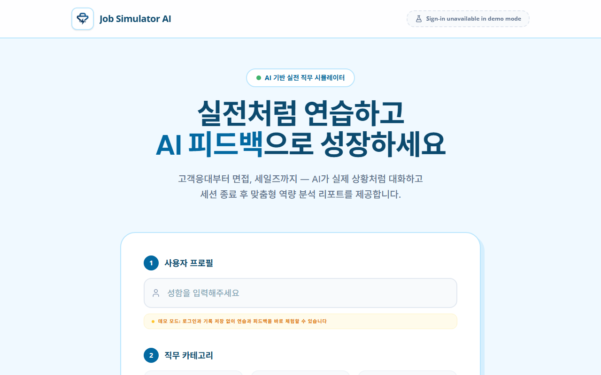
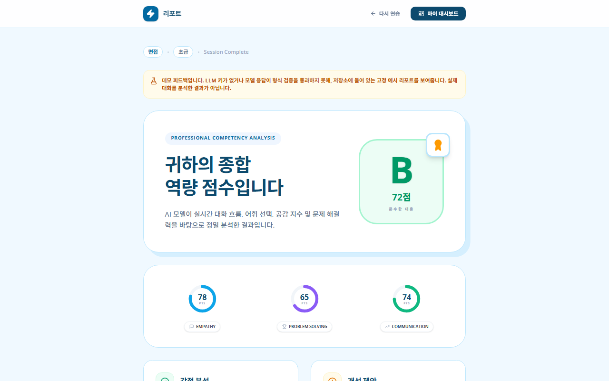
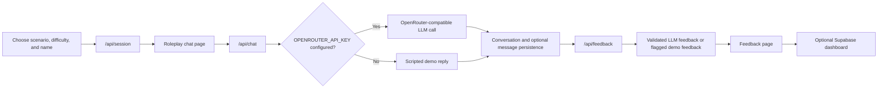

# Job Simulator AI

LLM roleplay practice for interviews, customer support, and sales.

[한국어](README.ko.md) · [Case study](PORTFOLIO.md)

Built in 8 days for the 2026 KEG Vibe Coding Contest (Apr 6–13, 2026).

<p>
  
  
</p>

*Demo mode with no environment variables: the landing page (left) and the labeled demo feedback report (right).*

A Next.js web app. The user picks a conversation type and a difficulty,
roleplays with an LLM counterpart, and then receives an LLM-written feedback
report with strengths, improvements, and four 0-100 scores (overall,
empathy, problem solving, communication).

**Problem.** Practicing a hard conversation needs a counterpart who stays in
role and feedback that arrives in a usable shape.

**What is built.** Nine scenario prompts (3 categories x 3 difficulty levels)
in `lib/personas.ts`; session, chat, and feedback API routes; live LLM replies
through OpenRouter (a hosted gateway to many LLMs) when `OPENROUTER_API_KEY` is
set and scripted demo replies when it is not; optional Supabase (hosted
Postgres with auth) persistence and Google sign-in.

**Scope.** A working practice flow, not a proven coaching effect: no
deployment, user study, or model-quality evaluation, and the four scores are
LLM-generated without rubric calibration.

**Try it now.** `npm ci`, then `npm run dev`. No keys are needed: the full
flow (choose a scenario, chat, get feedback) runs on demo content, and the
header shows "Sign-in unavailable in demo mode". `npm run lint`,
`npx tsc --noEmit`, and `npm run build` pass with no environment variables.

## At a glance

LLM-generated parts are marked; everything else is plain code that does not
go through the LLM.

- Three scenario categories (customer support, interview, sales), each with
  beginner, intermediate, and advanced prompt variants in `lib/personas.ts`.
  Opening lines are fixed text per scenario.
- Session creation through `/api/session`, with a UUID fallback when Supabase
  is not configured.
- A roleplay chat route that calls an OpenRouter-compatible OpenAI client when
  `OPENROUTER_API_KEY` is available (**LLM-generated** replies), or returns
  scripted demo replies.
- A feedback route that requests structured strengths, improvements, and four
  numeric scores from the LLM (**LLM-generated**), or returns fixed demo
  feedback without an API key.
- A hand-written validator (`lib/feedback.ts`) that checks the model's JSON:
  two non-empty text fields and four scores from 0 to 100. Invalid output
  returns the demo report with `demo: true` and
  `fallbackReason: "invalid_llm_output"` instead of HTTP 500, and the feedback
  page labels it as demo content.
- One shared label map (`SCORE_LABELS`) for the feedback page and dashboard,
  matching the prompt's score definitions.
- Optional Google OAuth, Supabase persistence, per-session feedback display,
  and a dashboard that aggregates stored feedback for the signed-in user.
  Without Supabase, `getSupabase()` returns `null`, every caller skips auth and
  storage, and the dashboard shows a demo-mode notice.

## Application flow



## Architecture and data handling

| Layer | Responsibility | Files |
|---|---|---|
| Client | Scenario selection, chat, feedback view, dashboard, and webview guidance | `app/page.tsx`, `app/roleplay/page.tsx`, `app/feedback/page.tsx`, `app/dashboard/page.tsx`, `components/` |
| API | Session lifecycle, roleplay response, and structured feedback request | `app/api/session/route.ts`, `app/api/chat/route.ts`, `app/api/feedback/route.ts` |
| LLM | Scenario prompts in `lib/personas.ts`; OpenRouter-compatible chat completion calls in API routes | `lib/personas.ts`, `app/api/chat/route.ts`, `app/api/feedback/route.ts` |
| Validation | Feedback shape check, score labels, demo report | `lib/feedback.ts` |
| Persistence | Optional Supabase client (`null` when unset) and tables for sessions, messages, and feedback | `lib/supabase.ts`, `lib/auth.ts` |

Without Supabase credentials, the API routes use the demo path and the client
keeps feedback in `sessionStorage` only.

## Environment variables

Copy [`.env.example`](.env.example) to `.env.local` and fill in only the
integrations you need:

| Variable | Effect when set | When empty |
|---|---|---|
| `OPENROUTER_API_KEY` | Live LLM replies and feedback | Scripted demo replies and fixed demo feedback |
| `OPENROUTER_MODEL` | Overrides the model | `google/gemini-2.0-flash-exp:free` (source default) |
| `NEXT_PUBLIC_SUPABASE_URL`, `NEXT_PUBLIC_SUPABASE_ANON_KEY` | Google sign-in and database persistence | Sign-in disabled; random session UUID; feedback kept in `sessionStorage` |

The database type declaration expects `sessions`, `messages`, and `feedback`
tables.

## How to run

Requires Node.js 18.18 or later (the Next.js 15 requirement). The package
scripts use Next.js 15.1.4:

```powershell
npm ci
npm run dev
# optional: copy .env.example .env.local and fill in keys (see the table above)
```

Open the local URL reported by Next.js. With no variables set, `/api/chat` and
`/api/feedback` return scripted content and `/api/session` returns a random
UUID.

Checks (all pass with no environment variables):

```powershell
npm run lint
npx tsc --noEmit
npm run build
```

## Repository layout

```text
app/
  api/                 # Session, chat, and feedback route handlers
  auth/                # OAuth callback/error paths
  roleplay/            # Conversation interface
  feedback/            # Per-session LLM feedback display
  dashboard/           # Stored-session summary for signed-in users
components/             # Authentication and webview UI helpers
lib/                    # Personas, feedback validation, Supabase client, auth helpers
public/                 # Logo and favicon
.env.example            # Variable names only; no values
```

## Limitations

- No deployment, user study, latency benchmark, or model-quality evaluation; the app shows a working practice flow, not proven coaching effect.
- The four scores (`total_score`, `empathy_score`, `problem_solving_score`, `communication_score`) are LLM-generated with no rubric calibration or human-rater agreement; use them for practice reflection, not employment, educational, or other high-stakes decisions.
- When the model's JSON fails validation, the user sees the fixed demo report (labeled as demo), not an analysis of their conversation.
- No automated tests; verification is lint, type check, build, and manual API and browser checks.

## Documentation

- [Case study](PORTFOLIO.md)
- [Architecture](docs/ARCHITECTURE.md)
