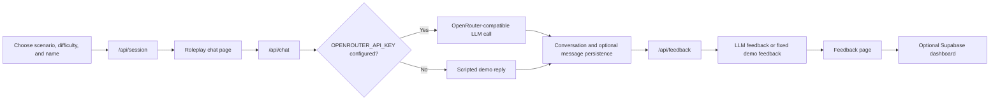

# Job Simulator AI

[한국어](README.ko.md) · [Project details](PORTFOLIO.md)

A Next.js web app for practising customer-support, job-interview, and sales
conversations. The user picks a conversation type and a difficulty, roleplays
with an LLM counterpart, and then receives an LLM-written feedback report with
strengths, improvements, and four 0-100 scores. Without an LLM key it runs a
scripted demo path.

**What is built:** nine scenario prompts (3 categories x 3 difficulty levels)
in `lib/personas.ts`; session/chat/feedback API routes; live LLM replies
through OpenRouter (a hosted gateway to many LLMs) when `OPENROUTER_API_KEY` is
set and scripted demo replies when it is not; optional Supabase (hosted
Postgres with auth) persistence and Google sign-in.

**Try it:** `npm ci` then `npm run dev`; chat and feedback return demo content
without keys (see [Limitations](#limitations) for the Supabase dependency).

Where to look: [case study and design decisions](PORTFOLIO.md) ·
[application flow](#application-flow) · [running locally](#run-locally) ·
[limitations](#limitations).

## What is implemented

LLM-generated parts are marked; everything else is deterministic code.

- Three scenario categories (customer support, interview, sales), each with
  beginner, intermediate, and advanced prompt variants in `lib/personas.ts`.
  Opening lines are fixed text per scenario.
- Session creation through `/api/session`, with a UUID fallback when Supabase
  is not configured.
- A roleplay chat route that calls an OpenRouter-compatible OpenAI client when
  `OPENROUTER_API_KEY` is available (**LLM-generated** replies), or returns
  scripted demo replies.
- A feedback route that requests structured strengths, improvements, and four
  numeric scores from the LLM (**LLM-generated**), or returns fixed demo
  feedback without an API key.
- Optional Google OAuth, Supabase persistence, per-session feedback display,
  and a dashboard that aggregates stored feedback for the signed-in user.

## Application flow



## Architecture and data handling

| Layer | Responsibility | Evidence |
|---|---|---|
| Client | Scenario selection, chat, feedback view, dashboard, and webview guidance | `app/page.tsx`, `app/roleplay/page.tsx`, `app/feedback/page.tsx`, `app/dashboard/page.tsx`, `components/` |
| API | Session lifecycle, roleplay response, and structured feedback request | `app/api/session/route.ts`, `app/api/chat/route.ts`, `app/api/feedback/route.ts` |
| LLM | Scenario prompts in `lib/personas.ts`; OpenRouter-compatible chat completion calls in API routes | `lib/personas.ts`, `app/api/chat/route.ts`, `app/api/feedback/route.ts` |
| Persistence | Supabase browser client and tables for sessions, messages, and feedback | `lib/supabase.ts`, `lib/auth.ts` |

Without Supabase credentials, the API routes use the demo path and the client
keeps feedback in `sessionStorage` only.

## Environment variables

Copy [`.env.example`](.env.example) to `.env.local` and fill in only the
integrations you need:

| Variable | Effect when set | When empty |
|---|---|---|
| `OPENROUTER_API_KEY` | Live LLM replies and feedback | Scripted demo replies and fixed demo feedback |
| `OPENROUTER_MODEL` | Overrides the model | `google/gemini-2.0-flash-exp:free` (source default) |
| `NEXT_PUBLIC_SUPABASE_URL`, `NEXT_PUBLIC_SUPABASE_ANON_KEY` | Google sign-in and database persistence | Random session UUID; feedback kept in `sessionStorage` |

The database type declaration expects `sessions`, `messages`, and `feedback`
tables.

## Run locally

Requires Node.js 18.18 or later (the Next.js 15 requirement; no `engines`
field is pinned). The package scripts use Next.js 15.1.4:

```powershell
npm ci
copy .env.example .env.local   # optional; see the table above
npm run dev
```

Open the local URL reported by Next.js. With no variables set, `/api/chat` and
`/api/feedback` return scripted content and `/api/session` returns a random
UUID.

## Repository structure

```text
app/
  api/                 # Session, chat, and feedback route handlers
  auth/                # OAuth callback/error paths
  roleplay/            # Conversation interface
  feedback/            # Per-session LLM feedback display
  dashboard/           # Stored-session summary for signed-in users
components/             # Authentication and webview UI helpers
lib/                    # Personas, Supabase client, and auth helpers
public/                 # Logo and favicon
.env.example            # Variable names only; no values
```

## Limitations

- Source code only: no verified production deployment, user study, latency benchmark, hiring outcome, or model-quality evaluation.
- The four scores (`total_score`, `empathy_score`, `problem_solving_score`, `communication_score`) are LLM-generated with no rubric calibration, human rater agreement, test set, fairness analysis, or reliability evidence; use them for practice reflection, not employment, educational, or other high-stakes decisions.
- The feedback page and dashboard label `empathy_score` as "COMMUNICATION" and `communication_score` as "ADAPTABILITY" (`app/feedback/page.tsx`, `app/dashboard/page.tsx`).
- The feedback route parses model text as JSON without schema validation; a malformed response returns HTTP 500.
- The landing page and sign-in button call the Supabase client on load, and `lib/supabase.ts` throws when the Supabase variables are unset, so a browser run without them is unconfirmed (found by reading the code).
- `npm run lint` and `npm run build` are unconfirmed in a clean `npm ci` install (a November 2026 attempt against an incomplete `node_modules` could not start); `next.config.ts` sets `eslint.ignoreDuringBuilds` and `typescript.ignoreBuildErrors`, so a build alone would not show lint or type checks pass.
- The Supabase schema and RLS SQL are not versioned here, and there are no integration tests.
- Demo mode does not bound client-supplied conversation data; no abuse controls, rate limits, or observability around LLM calls.

## Documentation

- [Portfolio case study](PORTFOLIO.md)
- [Project review](docs/PROJECT_REVIEW.md)
- [Architecture](docs/ARCHITECTURE.md)
- [CV bullet guidance](docs/CV_BULLETS.md)
