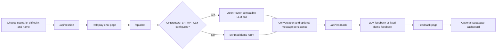

# AI Job Simulator

[한국어](README.ko.md) · [Project details](PORTFOLIO.md)

A Next.js web app where a user picks a conversation type (customer support,
job interview, or sales) and a difficulty, roleplays with an LLM counterpart,
and then receives an LLM-written feedback report with strengths, improvements,
and four 0-100 scores.

Practising these conversations normally needs a partner who can stay in role
and give feedback afterwards; the app supplies both, and runs a scripted demo
path when no LLM key is configured.

**What is built:** nine scenario prompts (3 categories x 3 difficulty levels)
in `lib/personas.ts`, session/chat/feedback API routes, a live LLM path through
OpenRouter (a hosted gateway to many LLMs) when `OPENROUTER_API_KEY` is set and
scripted demo replies when it is not, plus optional Supabase (hosted Postgres
with auth) persistence and Google sign-in. Commits run 6-13 Apr 2026 and,
apart from the initial Next.js scaffold, are all under the repository owner's
account; no team is recorded.

**Try it:** `npm ci` then `npm run dev`; chat and feedback return demo content
without keys (see the [Supabase caveat](#run-locally)).

> **Evidence boundary:** this repository contains source code, not a verified
> production deployment, user study, latency benchmark, hiring outcome, or
> model-quality evaluation. Feedback scores are generated by an LLM and must
> not be treated as validated assessments or automated hiring decisions.

Where to look: [case study and design decisions](PORTFOLIO.md) ·
[application flow](#application-flow) · [running locally and demo mode](#run-locally) ·
[known issues](#known-issues).

## What is implemented

LLM-generated parts are marked; everything else is deterministic code.

- Three scenario categories—customer support, interview, and sales—each with
  beginner, intermediate, and advanced prompt variants in `lib/personas.ts`.
  Opening lines are fixed text per scenario.
- Session creation through `/api/session`, with a UUID fallback when Supabase
  is not configured.
- A roleplay chat route that calls an OpenRouter-compatible OpenAI client when
  `OPENROUTER_API_KEY` is available (**LLM-generated** replies), or uses
  scripted demo replies otherwise.
- A feedback route that requests structured strengths, improvements, and four
  numeric scores from the LLM (**LLM-generated**), or returns fixed demo
  feedback without an API key.
- Optional Google OAuth, Supabase persistence, per-session feedback display,
  and a dashboard that aggregates the stored feedback fields for the signed-in
  user.

## Application flow



## Architecture and data handling

| Layer | Responsibility | Evidence |
|---|---|---|
| Client | Scenario selection, chat, feedback view, dashboard, and webview guidance | `app/page.tsx`, `app/roleplay/page.tsx`, `app/feedback/page.tsx`, `app/dashboard/page.tsx`, `components/` |
| API | Session lifecycle, roleplay response, and structured feedback request | `app/api/session/route.ts`, `app/api/chat/route.ts`, `app/api/feedback/route.ts` |
| LLM | Scenario prompts in `lib/personas.ts`; OpenRouter-compatible chat completion calls in API routes | `lib/personas.ts`, `app/api/chat/route.ts`, `app/api/feedback/route.ts` |
| Persistence | Supabase browser client and tables for sessions, messages, and feedback | `lib/supabase.ts`, `lib/auth.ts` |

When Supabase credentials are absent, the API routes intentionally support a
demo path. In that path, the client retains feedback in `sessionStorage`; it is
not durable user history.

## Environment variables

Copy [`.env.example`](.env.example) to `.env.local` and fill in only the
integrations you intend to use:

| Variable | Effect when set | When empty |
|---|---|---|
| `OPENROUTER_API_KEY` | Live LLM replies and feedback | Scripted demo replies and fixed demo feedback |
| `OPENROUTER_MODEL` | Overrides the model | `google/gemini-2.0-flash-exp:free` (source default) |
| `NEXT_PUBLIC_SUPABASE_URL`, `NEXT_PUBLIC_SUPABASE_ANON_KEY` | Google sign-in and database persistence | Random session UUID; feedback kept in `sessionStorage` |

The database type declaration expects `sessions`, `messages`, and `feedback`
tables. Their schema/RLS SQL is not versioned in this checkout, so provisioning
and access-policy verification remain external setup work.

## Run locally

Prerequisite: Node.js 18.18 or later (the Next.js 15 requirement; the package
does not pin an `engines` field). The declared package scripts use Next.js
15.1.4:

```powershell
npm ci
copy .env.example .env.local   # optional; see the table above
npm run dev
```

Open the local URL reported by Next.js.

**Run-check status.** In November 2026, `npm run lint` and `npm run build` were
attempted against an incomplete local `node_modules` and could not start (the
`next` and `eslint` executables were missing), so neither has been confirmed in
a clean `npm ci` install. `next.config.ts` sets `eslint.ignoreDuringBuilds` and
`typescript.ignoreBuildErrors`, so a successful build would not by itself show
that lint or type checks pass.

**Demo mode without keys.** With no variables set, `/api/chat` and
`/api/feedback` return scripted content and `/api/session` returns a random
UUID. However, the landing page and the sign-in button call the Supabase client
on load, and `lib/supabase.ts` throws when the Supabase variables are unset, so
a browser session with no Supabase variables has not been confirmed to work.
This was found by reading the code, not by running it.

## Feedback-score boundary

The feedback API asks an LLM to return `total_score`, `empathy_score`,
`problem_solving_score`, and `communication_score`. The repository does not
contain a rubric calibration dataset, human rater agreement, test set,
fairness analysis, or reliability evidence. Use the output as practice
reflection only—not as an employment, educational, or high-stakes decision.

## Known issues

- The feedback page and dashboard label `empathy_score` as "COMMUNICATION" and
  `communication_score` as "ADAPTABILITY" (`app/feedback/page.tsx`,
  `app/dashboard/page.tsx`), so on-screen labels do not match the fields the
  prompt asks for.
- The feedback route parses the model's text as JSON without schema validation;
  a malformed response returns HTTP 500.
- The Supabase-on-load dependency described under [Run locally](#run-locally).

## Repository structure

```text
app/
  api/                 # Session, chat, and feedback route handlers
  auth/                # OAuth callback/error paths
  roleplay/            # Conversation interface
  feedback/            # Per-session LLM feedback display
  dashboard/           # Stored-session summary for signed-in users
components/             # Authentication and webview UI helpers
lib/                    # Personas, Supabase client, and auth helpers
public/                 # Logo and favicon
.env.example            # Variable names only; no values
```

## Limitations and next steps

- Add a versioned Supabase schema, row-level-security policy, and integration
  tests before treating persistence or access control as production-ready.
- Validate and normalize LLM feedback with a documented rubric, human review,
  reliability measurements, and clear score labels.
- Bound client-supplied conversation data in demo mode and add abuse controls,
  rate limits, and observability around LLM calls.
- Verify current deployment status, supported providers/models, and browser
  behavior separately; no deployment evidence is stored here.

## Documentation

- [Portfolio case study](PORTFOLIO.md)
- [Project review](docs/PROJECT_REVIEW.md)
- [Architecture](docs/ARCHITECTURE.md)
- [CV bullet guidance](docs/CV_BULLETS.md)
